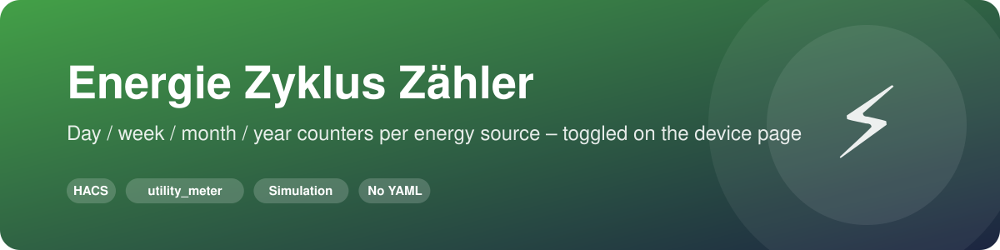
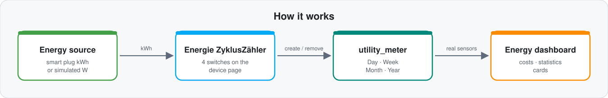
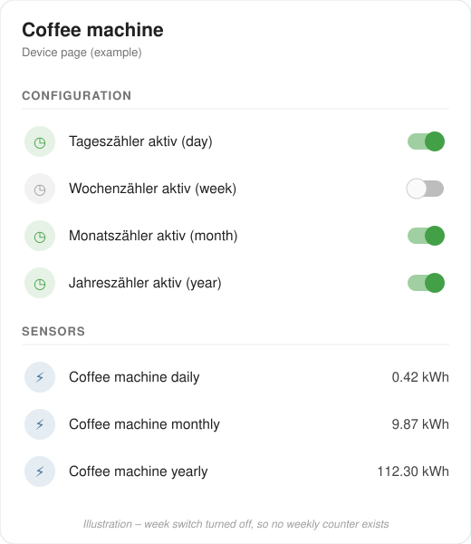
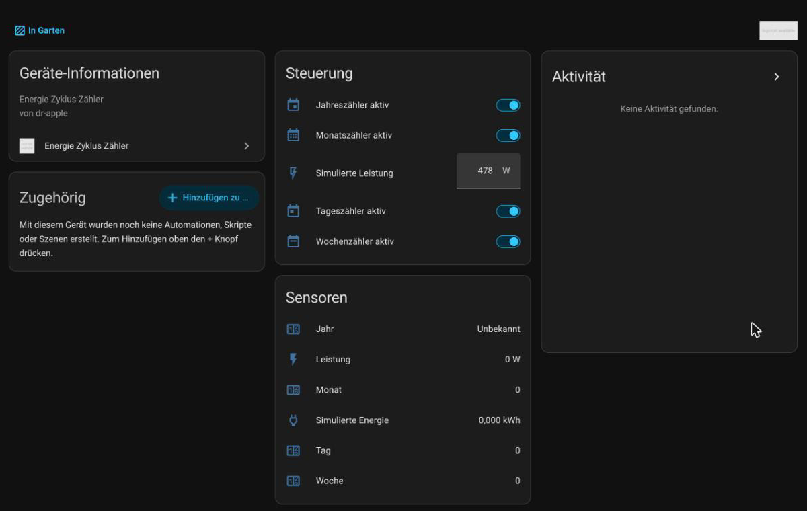

# Energie Zyklus Zähler

[English](README.md) · **Deutsch**

[](https://hacs.xyz)



Eine kleine Home-Assistant-Integration für die typische Situation „Ich habe viele Zwischenstecker mit Verbrauchsmessung und möchte für jeden einen Tages-, Wochen-, Monats- und Jahreszähler“ – ohne pro Stecker vier [`utility_meter`](https://www.home-assistant.io/integrations/utility_meter/)-Helfer von Hand anzulegen und ohne einen eigenen Optionsdialog.

## Warum

Der eingebaute `utility_meter`-Helfer von Home Assistant zählt bereits korrekt – Zyklus-Resets, Monatslängen, Schaltjahre und Quellsensoren, die gelegentlich auf null springen. Das muss niemand neu bauen. Was fehlt, ist ein schneller Weg zu sagen: *„Für diesen Energiesensor will ich einen Tages- und einen Monatszähler, aber keinen Wochen- und Jahreszähler“* – und das später wieder ändern zu können, ohne etwas neu anzulegen.

Diese Integration ist ein dünner, entitätsbasierter Verwalter über `utility_meter`:

- Einen Energiesensor einmal über **Einstellungen → Geräte & Dienste → Integration hinzufügen → „Energie Zyklus Zähler“** hinzufügen.
- Du bekommst eine Geräteseite mit vier Schaltern – **Tageszähler aktiv**, **Wochenzähler aktiv**, **Monatszähler aktiv**, **Jahreszähler aktiv** – standardmäßig alle an.
- Jeder Schalter legt im Hintergrund den passenden `utility_meter`-Eintrag an (oder entfernt ihn). Der entstehende Zählersensor erscheint auf derselben Geräteseite – alles zu einem Stecker liegt an einer Stelle.
- Schalter später aus → Zähler verschwindet. Wieder an → er kommt mit frischem Zyklus zurück, genau wie neu angelegt.

Kein Optionsdialog, kein YAML, keine eigene Einstellungsseite – die Schalter auf der Geräteseite *sind* die Konfiguration.





*Illustration – der Wochenschalter ist aus, deshalb gibt es für diesen Stecker keinen Wochenzähler.*



*Echter Screenshot aus einer Home-Assistant-Installation (persönliche Daten ersetzt).*

## Installation

### HACS (benutzerdefiniertes Repository)

1. HACS → Integrationen → ⋮ → Benutzerdefinierte Repositories.
2. `https://github.com/dr-apple/ha-energie-zyklus-zaehler` hinzufügen, Kategorie „Integration“.
3. „Energie Zyklus Zähler“ installieren, Home Assistant neu starten.

### Manuell

Den Ordner `custom_components/energie_zyklus_zaehler` nach `config/custom_components/` kopieren und Home Assistant neu starten.

## Einrichtung

1. **Einstellungen → Geräte & Dienste → Integration hinzufügen → „Energie Zyklus Zähler“**.
2. Eine von zwei Quellen wählen:
   - **Echten Energiesensor verwenden** – einen vorhandenen Energiesensor wählen (gefiltert auf `device_class: energy`), optional einen Namen vergeben.
   - **Verbrauch simulieren** – für Geräte ohne eigene Messung, aber mit bekanntem, ungefähr gleichbleibendem Verbrauch (ein Sat-Multischalter, der 24/7 läuft, ein Netzwerk-Switch …): Name und Wattzahl angeben. Ein Sensor `Simulierte Energie` summiert daraus kWh über die Zeit – genau wie ein echter `total_increasing`-Energiesensor. Die Wattzahl lässt sich danach jederzeit über die Zahl-Entität `Simulierte Leistung` auf derselben Geräteseite ändern, ohne neu anzulegen. Ein Leistungssensor `Leistung` (W, `device_class: power`) zeigt die aktuelle Leistung (0 W, solange die Freigabe-Entität aus ist), damit das simulierte Gerät z. B. auch im Energie-Dashboard als Leistungssensor wählbar ist.
     **Optional:** eine Freigabe-Entität wählen (Schalter, `input_boolean`, Binärsensor …) – dann wird nur gezählt, solange sie `on` ist, z. B. eine Gartenpumpe mit 700 W, die nur läuft, solange `switch.garten_wasserpumpe` an ist. Die Freigabe lässt sich später über **Konfigurieren** ändern oder entfernen.
3. Für jeden Zwischenstecker / Energiesensor / jedes simulierte Gerät wiederholen.
4. Auf jeder Geräteseite mit den vier Schaltern wählen, welche Zyklen du für diese Quelle wirklich willst.

## Beispiele

**Tageskosten eines Steckers** (Template-Sensor, Preis fest oder aus einem `input_number`):

```yaml
template:
  - sensor:
      - name: Kaffeemaschine Kosten heute
        unit_of_measurement: "€"
        state: >
          {{ (states('sensor.kaffeemaschine_taglich') | float(0) * 0.32) | round(2) }}
```

**Simuliertes Dauergerät** – z. B. ein Netzwerk-Switch mit konstant 9 W: *Verbrauch simulieren*, Name `Netzwerk-Switch`, 9 W. Du bekommst `Simulierte Energie` (kWh, total_increasing), `Leistung` (W) und die Zykluszähler – fertig fürs Energie-Dashboard als *einzelnes Gerät*.

**Gartenpumpe mit Freigabe** – 700 W, nur gezählt, solange `switch.garten_wasserpumpe` an ist: *Verbrauch simulieren*, 700 W, Freigabe-Entität `switch.garten_wasserpumpe`.

Die genauen Entity-IDs der Zähler stehen auf der Geräteseite.

## Hinweise

- Jeder Zykluszähler ist ein echter `utility_meter`-Sensor – er funktioniert also mit allem, was einen solchen erwartet: Energie-Dashboard, Kosten-Templates, Statistik-Karten. Diese Integration verwaltet nur, *welche* davon es für eine Quelle gibt.
- Wird der Integrationseintrag einer Quelle entfernt, werden auch alle `utility_meter`-Einträge entfernt, die er angelegt hat – nichts bleibt verwaist.
- Ein echter Quellsensor muss `state_class: total_increasing` (oder `total`) und `device_class: energy` haben – dieselbe Voraussetzung wie bei `utility_meter` selbst. Eine simulierte Quelle erfüllt das automatisch.
- Mit Freigabe-Entität wird Energie genau für die Zeiträume gebucht, in denen sie `on` war (Zustandswechsel werden sofort verbucht, nicht erst im 60-s-Takt). `unknown`/`unavailable` zählen als aus.
- Die Simulation geht von *konstanter* Last aus. Für Geräte mit stark schwankendem Verbrauch lieber einen echten Messstecker nehmen – Spitzen und Leerlauf erfasst die Simulation nicht.

## Fehlersuche

| Problem | Lösung |
|---|---|
| Sensor wird im Dialog nicht angeboten | Er braucht `device_class: energy` und `state_class: total_increasing` (oder `total`). |
| Zähler beginnt nach erneutem Einschalten bei 0 | So gewollt – ein wieder eingeschalteter Zyklus legt einen frischen `utility_meter` an. |
| Verwaiste Zähler | Beim Entfernen des Integrationseintrags werden alle zugehörigen `utility_meter` mit entfernt. |

## Lizenz

MIT – siehe [LICENSE](LICENSE).
